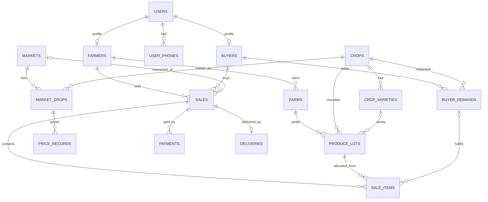

# Smart Mandi relational ER diagram

This diagram is based on the PostgreSQL DDL in `database/postgresql/01_core_tables.sql`, `02_inventory_market_demand.sql`, and `03_sales_payments_delivery.sql`. Quality observations are shown separately because they are MongoDB documents with logical references, not PostgreSQL foreign keys.

MongoDB `quality_observations` documents contain `lot_id`, `crop_id`, and `inspector_id`; only the lot ownership and crop reference are checked against PostgreSQL by application code. Mongo does not enforce those cross-database references as foreign keys.
